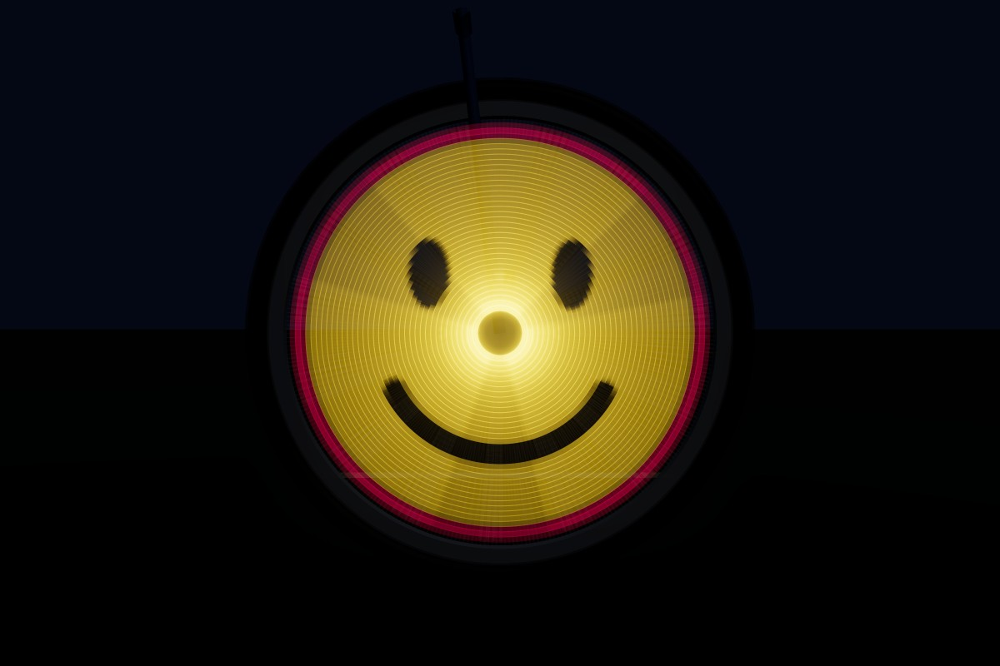
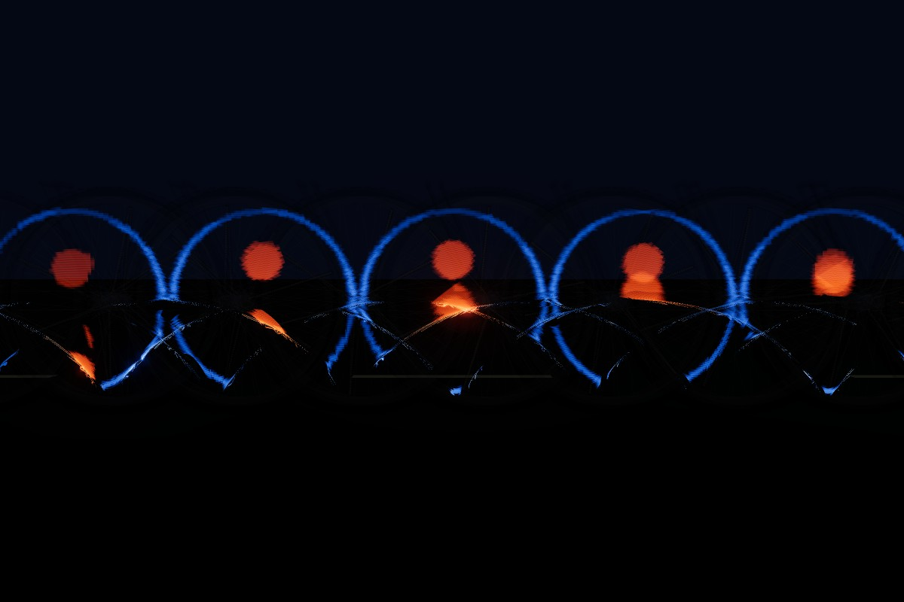

# POV Wheel Simulator

A tunable three.js simulation of a DIY persistence-of-vision (POV) bicycle wheel display, in the spirit of Adafruit's [CircuitPython POV Bike Wheel](https://learn.adafruit.com/circuitpython-pov-bike-wheel/overview). Use it to see what a build will look like *before* you cut LED strips: wheel size, strip count, LED density, speed, chip, LED type, firmware, and camera exposure are all adjustable.

**Live demo:** https://adamburr.github.io/pov-wheel-sim/



## Examples

These are all renders from the simulator, starting from the defaults (700c wheel, 3 strips of 144 LED/m APA102, RP2350) at a steady 10 mph with stop-and-go off, unless the caption says otherwise.

<table>
  <tr>
    <td width="50%"><br><sub><b>Human eye</b> (default): at 10 mph each point refreshes about 6 times a second, so you see fading sectors.</sub></td>
    <td width="50%"><br><sub><b>1/30 s photo:</b> each of the 3 strips sweeps only 25°.</sub></td>
  </tr>
  <tr>
    <td width="50%"><br><sub><b>WS2812B at 400 Hz PWM</b> (close-up, 2020 LEDs, no diffuser, 20 mph, 1/30 s): the arcs break into dashes.</sub></td>
    <td width="50%"><br><sub><b>Adafruit CircuitPython preset at 10 mph:</b> below its 400 lines/s floor the image squeezes, repeats and breaks up.</sub></td>
  </tr>
  <tr>
    <td width="50%"><br><sub><b>Ride-by, 1/4 s:</b> a fixed roadside camera sees the LEDs trace cycloids.</sub></td>
    <td width="50%"><br><sub><b>Banner mode, 2 s:</b> the image is pinned to the world and painted as the bike rides past.</sub></td>
  </tr>
  <tr>
    <td width="50%"><br><sub><b>Banner with 20% pedal surge and 4 ms hall polling:</b> dead-reckoning errors tear and double the text.</sub></td>
    <td width="50%"><br><sub><b>Animated banner:</b> frames advance as the bike travels, so the road becomes a flip-book.</sub></td>
  </tr>
</table>

## Running

```bash
npm install
npm run dev      # http://localhost:5173
npm test         # timing / firmware unit tests
npm run build
```

## How it works

Each frame is one simulated **exposure window**. A fragment shader on the LED plane works out, in closed form, every moment an LED's footprint covered each pixel during that window. It then integrates the light the LED was emitting at that moment: the column the firmware had latched, gated by the LED's PWM. Effects you see in real photos come out of the timing model rather than being drawn on:

- partial wedges at short shutter speeds, and a full image at long ones
- dashed arcs from low PWM rates (WS2812) or the APA102's slow global-brightness PWM
- image breakup below the Adafruit firmware's 400 lines/s floor
- stretching when the chip or LED bus can't send columns fast enough
- brighter hub area (inner LEDs sweep smaller circles)
- slight spiral twist from APA102 data rippling down the chain
- mirrored image on the non-drive side when back-to-back strips share data
- cycloid streaks when a roadside camera watches the bike ride by
- human-eye mode with exponential persistence instead of a box shutter

### Animations

Load an animated GIF, WebP, or APNG, or a short video clip, or pick one of the animated test patterns. Animated images decode through WebCodecs' `ImageDecoder` where the browser supports it; otherwise only the first frame is used. Videos are sampled at a set rate. The firmware stores one buffer per frame, and the stats warn when the frames won't fit in the chip's RAM.

Frames can advance on a timer (at the clip's fps) or every N wheel revolutions:
- **Timed** keeps the clip's speed. A frame can change mid-revolution, so different sectors show different frames (visible seams).
- **Revolution-synced** switches cleanly at the magnet, but the playback rate rises and falls with the bike's speed.

In banner mode the frames advance as the bike travels, so the road becomes a flip-book.

### Water mode

Pick **💧 show water** in the Water folder, or *Water (fluid sim)* as the test pattern, to fill the bottom of the disc with simulated water. Use the speed panel at the bottom of the screen to ride:
- Drag the slider to change speed.
- **🛑 Brake** stops the bike; **▶ Ride** sets off again.
- **🚦 Stop-and-go** (on by default) rides through the city automatically: it pulls away, cruises for 4–12 s, brakes for a light, and waits 2–6 s. Each light turns red at a random distance ahead (3–40 m), and the rider brakes just hard enough to stop there, so some stops are sharp and others a slow roll-down. Each pull-away varies too.

Speeding up pulses with every pedal stroke (*pedal surge speeding up*, default ±60% of the acceleration). The water surges against each speed change and sloshes back and forth afterwards. It's one body of water seen from both sides: from the non-drive side, braking pushes it to the viewer's left. The firmware model runs a small FLIP fluid simulation (default: a 24-cell grid with ~570 particles at 30 Hz). It paints each LED through a lookup table from LED position to grid cell, so no frames are stored.

**Rim drag.** The spinning rim drags the water touching it, using the wheel's speed as the magnet measures it. While riding, water is pulled back along the bottom and up the rear wall, where it tumbles over in breaking waves; when stopped, the rim is still and just damps the slosh. *Rim friction* (default 0.05) sets how strongly: around 0.2 or more carries the water all the way round into a ring, as real water in a spinning wheel would.

**Fluid presets:**
- **Water** (default): lively, little damping.
- **Splashy:** livelier still, with softer particle packing, so it throws more spray.
- **Thick (oil):** viscous, slow and heavy.

Each preset sets the FLIP ratio, viscosity and particle separation, all also adjustable individually.

**Rendering.** The LEDs read a map twice as fine as the simulation grid, built from the particles each step:
- the body of water is deep blue
- fast-moving surface water whitens into whitecaps
- loose droplets glint white as spray

A magnet-only build can't sense bumps, so there are no bump splashes.

*Slosh gain* (default 2×) multiplies the sensed acceleration. A real firmware might do the same so the motion still reads at POV refresh rates; set it to 1 for strict physics.

The firmware senses braking from the magnet alone: the change in revolution time between the last two passes. The estimate arrives about a revolution late. Hard braking also rotates the whole picture until the next pass, because the firmware assumes the wheel kept its last speed. *Ideal* sync shows the best case, with no lag or angle error. A 6-axis IMU at the axle would close most of that gap.

The **📊 Build stats** section of the settings menu shows:
- the estimated sensed vs true acceleration
- the simulation's MFLOP/s as a share of one core on the chosen chip (about 33% of an RP2350 core at the defaults)
- firmware RAM for the lookup table and simulation state

### Banner mode

Set **Image → display mode** to *banner (world-locked)* and the image stops turning with the wheel. It is pinned to the world instead and tiles along the road. At every update the firmware works out where each LED is and lights it with that spot of the banner, so the spinning strips act like a scanner that reveals a picture hanging in the air. Seen from the roadside with a long exposure, the bike paints the banner as it rides by.

Position comes from hall-sensor dead reckoning: whole turns at each magnet pass, plus the time since the pass divided by the last revolution period. Polling delay and pedal surges show up as a torn or doubled banner. *Predict motion* computes each update for the middle of the time it's displayed instead of when it's sent. The *ideal* sync mode shows the best case. LEDs near the ground move slowly relative to the road and leave bright cusps, while the top edge streaks past at about twice road speed. The bitmap is stored at about one pixel per LED pitch, as tall as the LEDs reach.

### Parameters

| Group | Highlights |
|---|---|
| Wheel | Size presets (700c default, 29", 27.5", 26", 24", 20", 16", 12"), tire width, rim depth, spokes |
| Strips & LEDs | Strip count, LED/m, package size, diffuser, start radius, double-sided, back-strip data (independent by default, so images read correctly from both sides; *same* mirrors the non-drive side like the Adafruit wiring), radial stagger |
| Ride | Large speed panel (slider, live readout, brake / ride, stop-and-go), mph or km/h, pedal surge cruising and speeding up, cadence, speed-change and braking rates, stop-and-go cruise speed |
| Electronics | Chip preset (ATmega328P → Teensy 4.x, RP2350 default), LED type (APA102, SK9822, HD107S, WS2812B, SK6812), clock, parallel lanes, overhead, PWM, global brightness |
| Firmware | C/Arduino hall-sensor, Adafruit CircuitPython guide behaviour, or ideal encoder-locked; columns/rev, lines/s floor, hall poll, debounce |
| Image | Wheel-locked or banner (world-locked) display, load/drop/paste an image, animated GIF/WebP/APNG, or video, or pick a test pattern (some animated), polar (picture) or Adafruit columns-as-angles mapping, gamma, bit depth, inner-LED dimming |
| Water | Fluid preset (water, splashy, thick), rim friction, FLIP ratio, viscosity, particle separation, fill, grid size, sim rate, pressure iterations, slosh gain, acceleration smoothing |
| Animation | Timed or revolution-synced frame advance, playback rate (×, kept across clips), source fps, revolutions per frame, import frame limit, video sample rate |
| Camera | Chase or ride-by view, drive or non-drive side, shutter speed or human-eye persistence, auto exposure, EV, time scale |

The **📊 Build stats** section at the top of the **⚙️ Settings & stats** menu reports rpm, column timing, achievable resolution, refresh rate, RAM use, current draw, and battery life, with warnings for common pitfalls.

LED PWM rates vary between datasheets and clone parts, so every preset value can be edited.

## Layout

- `src/params.ts`: parameters and preset tables
- `src/sim/`: LED bus timing, wheel kinematics, hall-sensor firmware model, stats
- `src/image/`: test patterns, image loading, conversion to the firmware column buffer
- `src/render/`: POV integration shader, wheel model with motion blur, HDR/bloom, camera
- `test/`: unit tests for timing, the PWM integral, and the firmware model
